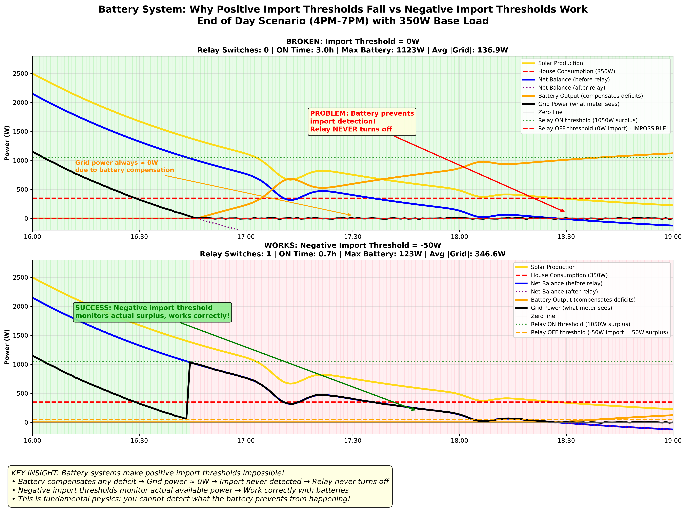
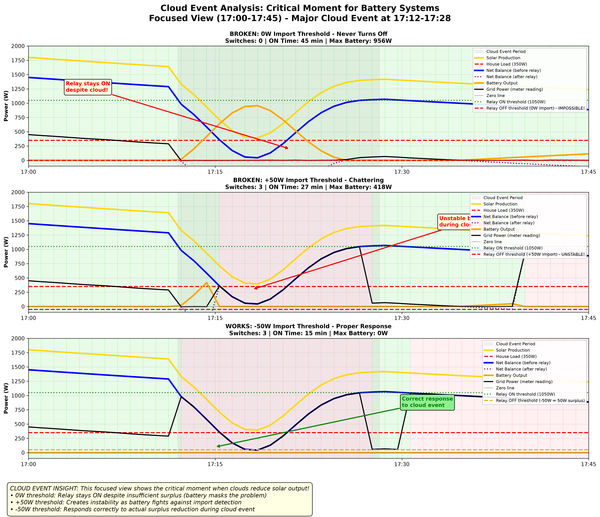
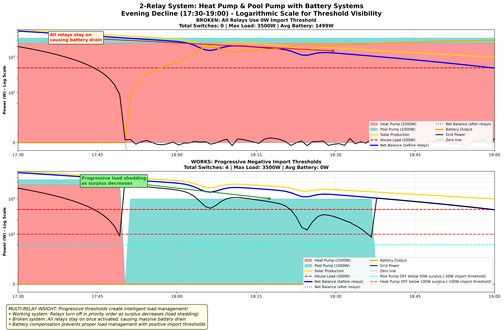

# Battery System Configuration Guide

[](BATTERY_CONFIGURATION_GUIDE.md)

- [Battery System Configuration Guide](#battery-system-configuration-guide)
  - [The problem](#the-problem)
  - [How a relay decides](#how-a-relay-decides)
  - [The fix: a negative import threshold](#the-fix-a-negative-import-threshold)
  - [Choosing the surplus threshold](#choosing-the-surplus-threshold)
  - [Examples](#examples)
  - [The graphs](#the-graphs)
    - [Graph 1: 0 W against -50 W](#graph-1-0-w-against--50-w)
    - [Graph 2: a cloud (17:00-17:45)](#graph-2-a-cloud-1700-1745)
    - [Graph 3: two relays, heat pump and pool pump (17:30-19:00)](#graph-3-two-relays-heat-pump-and-pool-pump-1730-1900)
  - [Troubleshooting](#troubleshooting)

## The problem

A home battery charges from the surplus and discharges to cover any import: the grid power stays
close to 0 W. A relay that waits for an import to turn OFF never sees one:

- import threshold 0 W: the relay turns ON on a surplus, then **never turns OFF**, since the
  battery covers its load;
- positive import threshold (e.g. 50 W): the battery hides the import as well, and any import it
  lets through is short: the relay may chatter.

## How a relay decides

The relays are set in `config.h`, with `RELAY_DIVERSION` set to `true`:

```cpp
inline constexpr bool RELAY_DIVERSION{ true };

inline constexpr uint8_t RELAY_FILTER_DELAY{ 2 };

inline constexpr RelayEngine relays{ MINUTES(RELAY_FILTER_DELAY),
                                     { { 8, 1550, -50, 10, 5 } } };
//                                       |   |     |   |   └─ minimum OFF time, minutes
//                                       |   |     |   └─ minimum ON time, minutes
//                                       |   |     └─ import threshold, W
//                                       |   └─ surplus threshold, W
//                                       └─ pin
```

Each relay is `{ pin, surplus, import, minON, minOFF }`; what is left out takes the defaults
1000 W, 200 W, 5 and 5 minutes (`config_types.h`). The engine (`relay_engine.h`):

- decides on the average grid power: a triple EMA (TEMA) of the power of each datalog line, over
  `RELAY_FILTER_DELAY` minutes (see [Cloud_Pattern_Tuning_Guide.md](../../docs/Cloud_Pattern_Tuning_Guide.md));
- turns a relay ON when the average surplus is above its surplus threshold;
- turns it OFF when the average grid power is above its import threshold: with a positive
  threshold, an import above it; with a negative one, a surplus below its absolute value;
- holds each relay for its minimum ON or OFF time, and waits 60 s after any relay change before
  the next one; one relay changes at a time: OFF from the last relay down, ON from the first up;
- never turns OFF a relay that an override pin or a scheduled boost forces.

## The fix: a negative import threshold

With an import threshold of -50, the relay turns OFF when the surplus falls below 50 W. The
battery cannot hide that: a surplus it absorbs to charge is still a surplus at the meter.

At startup the router prints the meaning of each threshold:

```
Import threshold: 200 (import mode)
Import threshold: -50 (surplus mode: turn OFF when surplus < 50W)
```

## Choosing the surplus threshold

The relay's own load is in the grid power it measures. Once the relay is ON, the surplus drops
by the load's power. If what is left is below the absolute value of the import threshold, the
relay turns itself OFF again as soon as its minimum ON time is over.

So the surplus threshold must be at least **the load's power + |import threshold|**: 1050 W or
more for a 1000 W load with -50 W. Add a margin for a load whose power varies.

| Load size | Import threshold |
|---|---|
| below 1 kW | -10 to -30 W |
| 1 to 3 kW | -20 to -50 W |
| above 3 kW | -50 to -100 W |
| noisy measurements | -100 W |

## Examples

```cpp
// Pool pump, 1500 W: OFF below 30 W of surplus, ON above 1550 W, 10 minutes ON at least
inline constexpr RelayEngine relays{ MINUTES(RELAY_FILTER_DELAY), { { 8, 1550, -30, 10, 5 } } };

// Water heater on a relay, 2000 W: OFF below 50 W of surplus, ON above 2100 W
inline constexpr RelayEngine relays{ MINUTES(RELAY_FILTER_DELAY), { { 8, 2100, -50, 15, 10 } } };

// Heat pump 2500 W first, then pool pump 1000 W
inline constexpr RelayEngine relays{ MINUTES(RELAY_FILTER_DELAY),
                                     { { 8, 2600, -100, 20, 20 },
                                       { 9, 1050, -50, 5, 5 } } };
```

The pins must be free in your configuration: the build refuses a pin used twice.

## The graphs

The graphs come from the Python scripts next to this guide (`battery_system_simulation.py`,
`cloud_event_analysis.py`, `multi_relay_analysis.py`; numpy and matplotlib). They illustrate the
rule, not the firmware: one decision per minute on the surplus, without the TEMA average or the
60 s settle time, and a battery with no limit. Each panel shows the solar production, the house
load, the balance before and after the relays, the battery output and the grid power.

### Graph 1: 0 W against -50 W



16:00 to 19:00, solar production falling from 2.5 kW, house 350 W, one 1000 W relay that turns ON
above 1050 W of surplus. Green background: relay ON; pink: relay OFF.

- Top, import threshold 0 W: the relay stays ON for the 3 hours; the battery covers it.
- Bottom, import threshold -50 W: the relay turns OFF once, when the surplus falls below 1050 W;
  ON 24 % of the time.

### Graph 2: a cloud (17:00-17:45)



A cloud from 17:12 to 17:28, the same house and relay, three import thresholds:

- 0 W: the relay stays ON through the cloud (0 switches);
- +50 W: 3 switches, ON 27 minutes; the chattering in the cloud is written into the script, not
  computed;
- -50 W: the relay turns OFF in the cloud, ON again after it, then OFF as the sun goes down
  (3 switches, ON 15 minutes).

### Graph 3: two relays, heat pump and pool pump (17:30-19:00)



Heat pump 2500 W, import threshold -100 W, 20 minutes minimum ON and OFF; pool pump 1000 W,
-50 W; house 500 W. A logarithmic scale, so that the 50 and 100 W levels show.

| | 0 W thresholds | Negative thresholds |
|---|---|---|
| Heat pump | ON for 90 minutes | 1 switch, ON 20 minutes |
| Pool pump | ON for 90 minutes | 3 switches, ON 66 minutes |
| Relay energy | 5250 Wh | 1933 Wh |

With the negative thresholds, the heat pump turns OFF after its 20 minutes; the pool pump runs
on while the surplus allows.

## Troubleshooting

- **The relay turns OFF right after its minimum ON time:** the surplus threshold is too low for
  the load: raise it to the load's power + |import threshold| or more.
- **The relay turns OFF too early in good sun:** make the import threshold more negative
  (e.g. -20 W to -50 W), and raise the surplus threshold by as much.
- **The relay never turns OFF:** check that the import threshold is negative, and that no override
  pin or scheduled boost forces the relay.
- **The relay chatters:** the threshold is too close to the measurement noise: make it more
  negative, or lengthen `RELAY_FILTER_DELAY` or the minimum ON and OFF times.
