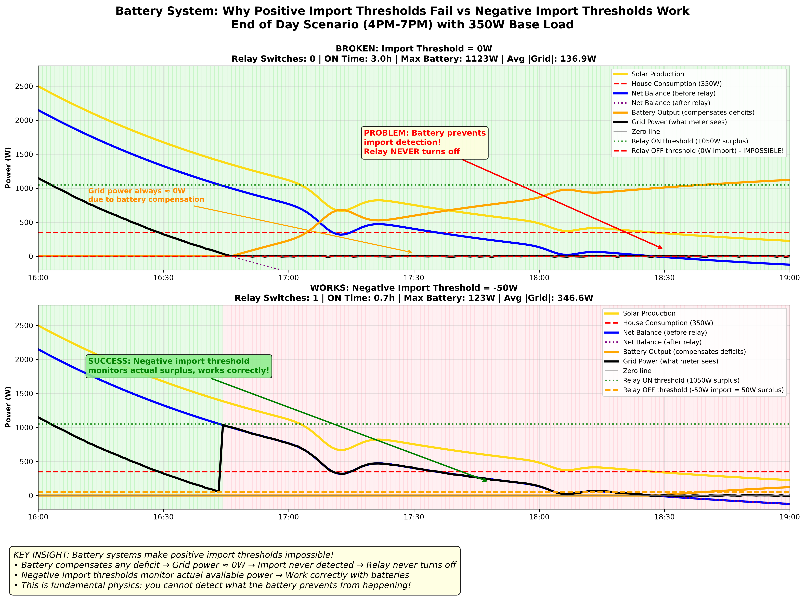
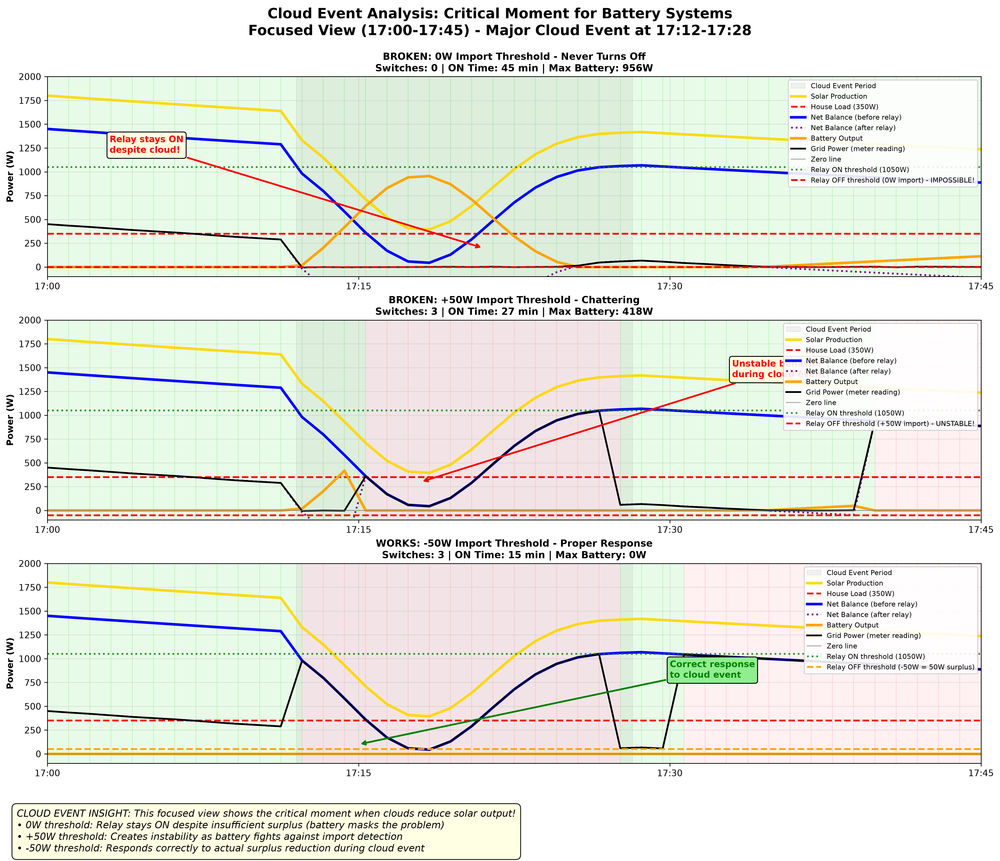
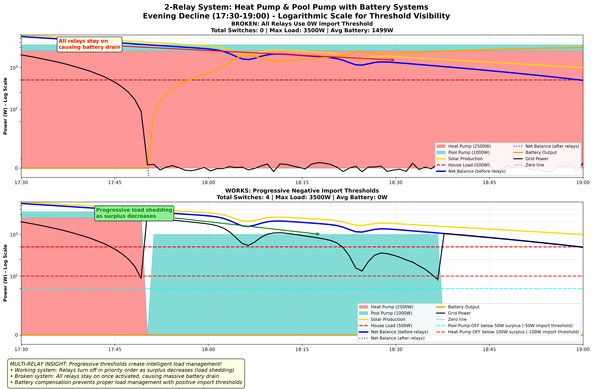

# Guide de configuration pour systèmes avec batterie

[](BATTERY_CONFIGURATION_GUIDE.en.md)

- [Guide de configuration pour systèmes avec batterie](#guide-de-configuration-pour-systèmes-avec-batterie)
  - [Le problème](#le-problème)
  - [Comment un relais décide](#comment-un-relais-décide)
  - [La solution, un seuil d'import négatif](#la-solution-un-seuil-dimport-négatif)
  - [Choisir le seuil de surplus](#choisir-le-seuil-de-surplus)
  - [Exemples](#exemples)
  - [Les graphiques](#les-graphiques)
    - [Graphique 1, 0 W contre -50 W](#graphique-1-0-w-contre--50-w)
    - [Graphique 2, un nuage (17:00-17:45)](#graphique-2-un-nuage-1700-1745)
    - [Graphique 3, deux relais, pompe à chaleur et pompe de piscine (17:30-19:00)](#graphique-3-deux-relais-pompe-à-chaleur-et-pompe-de-piscine-1730-1900)
  - [Dépannage](#dépannage)

## Le problème

Une batterie domestique se charge sur le surplus et se décharge pour couvrir tout import : la
puissance réseau reste proche de 0 W. Un relais qui attend un import pour s'éteindre n'en voit
jamais :

- seuil d'import 0 W : le relais s'allume sur un surplus, puis **ne s'éteint jamais**, puisque la
  batterie couvre sa charge ;
- seuil d'import positif (par ex. 50 W) : la batterie masque aussi l'import, et l'import qu'elle
  laisse passer est bref : le relais peut claquer.

## Comment un relais décide

Les relais se règlent dans `config.h`, avec `RELAY_DIVERSION` à `true` :

```cpp
inline constexpr bool RELAY_DIVERSION{ true };

inline constexpr uint8_t RELAY_FILTER_DELAY{ 2 };

inline constexpr RelayEngine relays{ MINUTES(RELAY_FILTER_DELAY),
                                     { { 8, 1550, -50, 10, 5 } } };
//                                       |   |     |   |   └─ temps minimal à l'arrêt, minutes
//                                       |   |     |   └─ temps minimal en marche, minutes
//                                       |   |     └─ seuil d'import, W
//                                       |   └─ seuil de surplus, W
//                                       └─ broche
```

Chaque relais s'écrit `{ pin, surplus, import, minON, minOFF }` ; ce qui est omis prend les
valeurs par défaut 1000 W, 200 W, 5 et 5 minutes (`config_types.h`). Le moteur (`relay_engine.h`) :

- décide sur la puissance réseau moyenne : une triple EMA (TEMA) de la puissance de chaque ligne
  du datalog, sur `RELAY_FILTER_DELAY` minutes (voir [Cloud_Pattern_Tuning_Guide.md](../../docs/Cloud_Pattern_Tuning_Guide.md)) ;
- allume un relais quand le surplus moyen dépasse son seuil de surplus ;
- l'éteint quand la puissance réseau moyenne dépasse son seuil d'import : avec un seuil positif,
  un import au-delà ; avec un seuil négatif, un surplus sous sa valeur absolue ;
- garde chaque relais pendant son temps minimal en marche ou à l'arrêt, et attend 60 s après tout
  changement de relais avant le suivant ; un seul relais change à la fois : extinction du dernier
  relais vers le premier, allumage du premier vers le dernier ;
- n'éteint jamais un relais forcé par une broche de forçage ou une marche forcée programmée.

## La solution, un seuil d'import négatif

Avec un seuil d'import de -50, le relais s'éteint quand le surplus moyen passe sous 50 W. Une
batterie qui couvre une partie de la charge du relais maintient le réseau près de 0 W, soit un
surplus sous 50 W : le relais s'éteint. Il ne s'allume que sur un surplus vu au compteur, donc
pas tant que la batterie absorbe le surplus pour se charger.

Au démarrage, le routeur affiche le sens de chaque seuil :

```
Import threshold: 200 (import mode)
Import threshold: -50 (surplus mode: turn OFF when surplus < 50W)
```

## Choisir le seuil de surplus

La charge du relais fait partie de la puissance réseau qu'il mesure. Une fois le relais allumé,
le surplus baisse de la puissance de la charge. Si ce qui reste est sous la valeur absolue du
seuil d'import, le relais s'éteint de lui-même dès la fin de son temps minimal en marche.

Le seuil de surplus doit donc valoir au moins **la puissance de la charge + |seuil d'import|** :
1050 W ou plus pour une charge de 1000 W avec -50 W. Ajoutez une marge pour une charge dont la
puissance varie.

| Taille de la charge | Seuil d'import |
|---|---|
| moins de 1 kW | -10 à -30 W |
| 1 à 3 kW | -20 à -50 W |
| plus de 3 kW | -50 à -100 W |
| mesures bruitées | -100 W |

## Exemples

```cpp
// Pompe de piscine, 1500 W : éteinte sous 30 W de surplus, allumée au-delà de 1550 W, 10 minutes en marche au moins
inline constexpr RelayEngine relays{ MINUTES(RELAY_FILTER_DELAY), { { 8, 1550, -30, 10, 5 } } };

// Chauffe-eau sur relais, 2000 W : éteint sous 50 W de surplus, allumé au-delà de 2100 W
inline constexpr RelayEngine relays{ MINUTES(RELAY_FILTER_DELAY), { { 8, 2100, -50, 15, 10 } } };

// Pompe à chaleur 2500 W d'abord, puis pompe de piscine 1000 W
inline constexpr RelayEngine relays{ MINUTES(RELAY_FILTER_DELAY),
                                     { { 8, 2600, -100, 20, 20 },
                                       { 9, 1050, -50, 5, 5 } } };
```

Les broches doivent être libres dans votre configuration : la compilation refuse une broche
utilisée deux fois.

## Les graphiques

Les graphiques viennent des scripts Python à côté de ce guide (`battery_system_simulation.py`,
`cloud_event_analysis.py`, `multi_relay_analysis.py` ; numpy et matplotlib). Ils illustrent la
règle, pas le firmware : une décision par minute sur le surplus, sans la moyenne TEMA ni l'attente
de 60 s, et une batterie sans limite. Chaque panneau montre la production solaire, la
consommation de la maison, le bilan avant et après les relais, la sortie de la batterie et la
puissance réseau.

### Graphique 1, 0 W contre -50 W



De 16:00 à 19:00, production solaire en baisse depuis 2,5 kW, maison 350 W, un relais de 1000 W
qui s'allume au-delà de 1050 W de surplus. Fond vert : relais allumé ; rose : relais éteint.

- En haut, seuil d'import 0 W : le relais reste allumé pendant les 3 heures ; la batterie le
  couvre.
- En bas, seuil d'import -50 W : le relais s'éteint une fois, quand le surplus passe sous
  1050 W ; allumé 24 % du temps.

### Graphique 2, un nuage (17:00-17:45)



Un nuage de 17:12 à 17:28, la même maison et le même relais, trois seuils d'import :

- 0 W : le relais reste allumé pendant le nuage (0 commutation) ;
- +50 W : 3 commutations, allumé 27 minutes ; le claquement pendant le nuage est écrit dans le
  script, pas calculé ;
- -50 W : le relais s'éteint pendant le nuage, se rallume après, puis s'éteint quand le soleil
  baisse (3 commutations, allumé 15 minutes).

### Graphique 3, deux relais, pompe à chaleur et pompe de piscine (17:30-19:00)



Pompe à chaleur 2500 W, seuil d'import -100 W, 20 minutes minimum en marche et à l'arrêt ; pompe
de piscine 1000 W, -50 W ; maison 500 W. Échelle logarithmique, pour que les niveaux de 50 et
100 W se voient.

| | Seuils à 0 W | Seuils négatifs |
|---|---|---|
| Pompe à chaleur | allumée 90 minutes | 1 commutation, allumée 20 minutes |
| Pompe de piscine | allumée 90 minutes | 3 commutations, allumée 66 minutes |
| Énergie des relais | 5250 Wh | 1933 Wh |

Avec les seuils négatifs, la pompe à chaleur s'éteint après ses 20 minutes ; la pompe de piscine
continue tant que le surplus le permet.

## Dépannage

- **Le relais s'éteint juste après son temps minimal en marche :** le seuil de surplus est trop
  bas pour la charge : montez-le à la puissance de la charge + |seuil d'import| ou plus.
- **Le relais s'éteint trop tôt en plein soleil :** rapprochez le seuil d'import de 0
  (par ex. de -50 W à -20 W) : le relais s'éteint alors sur un surplus plus faible.
- **Le relais ne s'éteint jamais :** vérifiez que le seuil d'import est négatif, et qu'aucune
  broche de forçage ni marche forcée programmée ne force le relais.
- **Le relais claque :** le seuil d'import est trop proche du bruit de mesure :
  éloignez-le de 0 et montez le seuil de surplus d'autant, ou allongez `RELAY_FILTER_DELAY` ou
  les temps minimaux en marche et à l'arrêt.
