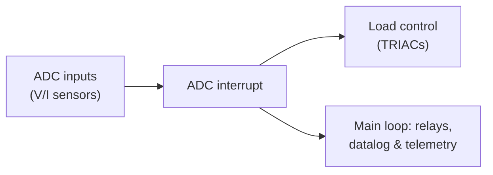

# Firmware Documentation

Technical documentation of the router firmware, and guides for some settings. The settings
themselves are described in [Readme.en.md](../Readme.en.md).

## Design

- **[Software Architecture](architecture.md)** - the ADC interrupt, the main loop, the headers
- **[Configuration System](configuration.md)** - how the settings reach the code, and what the build checks
- **[Performance Characteristics](performance.md)** - ADC interrupt timing, the ADMUX deadline, the main loop
- **[Memory Layout](memory-layout.md)** - flash and RAM use

## Guides

- **[Calibration values](calibration.md)** - where the default values of `calibration.h` come from
- **[Battery systems](BATTERY_CONFIGURATION_GUIDE.en.md)** ([français](BATTERY_CONFIGURATION_GUIDE.md)) - relay thresholds with a home battery
- **[Cloud pattern tuning](../../docs/Cloud_Pattern_Tuning_Guide.md)** - choosing `RELAY_FILTER_DELAY`

## Development

- **[Contributing Guide](contributing.md)** - setup, code rules, branches and pull requests
- **[Testing Guide](testing.md)** - native and embedded tests, compile-fail checks, the grid simulator, benchmarks

## Quick reference

- **ADC sampling:** one conversion every 104 µs (9.6 kHz), V and I of each of the three phases in turn
- **ADC interrupt:** 318 cycles (~20 µs) on average, of the 1664 cycles of a conversion
- **Compile-time checks:** every setting is checked by `validation.h`
- **Sensor data:** DS18B20 readings are checked (CRC, range, power-on value, `ds18b20.h`)
- **Polarity:** each phase's voltage polarity is confirmed before it counts (`processing.cpp`)
