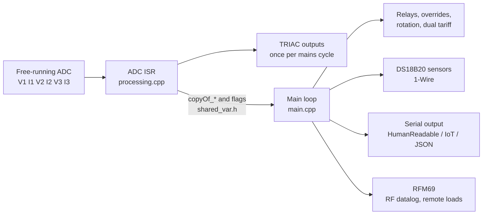

# Software Architecture

How the firmware is organized: the ADC interrupt that measures and switches, the main loop that
does the rest, and the headers each part lives in. The firmware is for the 3-phase board and the
ATmega328P only: the ADC chain has exactly six conversions (A0 to A5), and the ISR, the ADMUX
values and the port writes are specific to that chip.

## Overview

## The ADC interrupt

The ADC runs free, one conversion every 104 µs (1664 CPU cycles), through a fixed chain of six
channels: V1, I1, V2, I2, V3, I3 (`adc_chain.h`, set up in `initializeProcessing()`). The firmware
has one interrupt, `ISR(ADC_vect)` in `processing.cpp`:

1. it reads `ADC` (left-adjusted);
2. it calls `processVoltageRawSample()` or `processCurrentRawSample()` for the channel just
   converted;
3. it writes ADMUX last, for the conversion after next (the next one has already started);
4. it steps to the next entry of a circular list of six constant entries (`_channels`).

After each voltage sample, `processRawSamples()` acts on the zero crossings of the phase: at the
negative-going one, the DC offset of the phase is refreshed; at the positive-going one, the
phase's power of the cycle goes into the energy bucket (`processPlusHalfCycle()`). On phase 1,
the positive crossing also calls `processDataLogging()`, which at the end of each datalog period
copies the sums for the main loop, and two sample sets later `processStartNewCycle()` decides the
load states (`load_priorities.h`) and writes them to the ports (`updatePhysicalLoadStates()`).

The interrupt has no floating point, no allocation and no busy-wait. Its timing, and the ADMUX
deadline, are in [performance.md](performance.md).

## The main loop

`loop()` in `main.cpp` reads the flags of `shared_var.h`:

- `b_newMainsCycle`, once per mains cycle: a 1-Wire transaction with temperature sensing, and once
  per second the per-second tasks (dual tariff, override pins and scheduled boosts, router OFF and
  diversion pins, relays, load priorities and rotation);
- `b_datalogEventPending`, once per datalog period: power and voltage per phase from the
  `copyOf_*` copies, the relays' average, the temperatures, and the output.

It also writes the serial output in progress without waiting, and sends the RF frames of the
remote loads. The main loop passes back to the ISR, through `shared_var.h`, which outputs are
forced and whether diversion is on.

## Configuration

`config.h` holds the settings, `config_derived.h` builds what the code uses from them, and
`validation.h` checks them at compile time: see [configuration.md](configuration.md).

## Headers

| Header | Content |
|---|---|
| `processing.cpp/.h` | The ADC interrupt and the processing engine |
| `adc_chain.h` | The six conversions and the ADMUX pipeline |
| `energy_bucket.h` | Integer arithmetic of the energy bucket |
| `ct_filter.h` | The optional CT filter (settings in `calibration.h`) |
| `datalog_math.h` | Integer power and RMS voltage of the datalog |
| `load_priorities.h` | Which load to switch at each mains cycle |
| `load_map.h` | The load map: one packed byte per load, local or remote |
| `rotation_groups.h` | The loads that take turns at the top of the priorities |
| `override_masks.h`, `utils_override.h`, `pin_edges.h` | Forced outputs: override pins and scheduled boosts; edges of the input pins |
| `dualtariff.h`, `utils_dualtariff.h` | Off-peak period and the windows of the scheduled boosts |
| `relay_engine.h`, `utils_relay.h` | Relay decisions (thresholds, minimum times, settle time, TEMA average); the relay pins and printing |
| `ewma_avg.hpp` | The EMA, DEMA and TEMA averages |
| `remote_loads.h`, `remote_loads_core.h`, `utils_rf.h`, `config_rf.h` | RFM69: RF datalog and remote loads |
| `utils_temp.h`, `ds18b20.h`, `onewire_search.h`, `temp_schedule.h` | DS18B20 sensors: reading, checks, ROM search, scheduling of the 1-Wire transactions |
| `serial_output.h`, `teleinfo.h`, `utils.h` | Non-blocking serial output, the IoT frame; the startup configuration and the datalog output (`sendResults()`) |
| `debug.h` | Text output: `info()` (startup configuration, every output mode), `status()` (human-readable output only), `debug()` (only with `ENABLE_DEBUG`) |
| `shared_var.h` | The variables shared by the ISR and the main loop |
| `utils_pins.h`, `utils_bits.h` | Direct port access, bit helpers |
| `mult_asm.h`, `FastDivision.*` | Assembly multiplications and divisions |
| `config.h`, `config_types.h`, `config_system.h`, `config_derived.h`, `calibration.h`, `validation.h` | Configuration |

The Arduino-free headers are tested on the PC; see [testing.md](testing.md).
