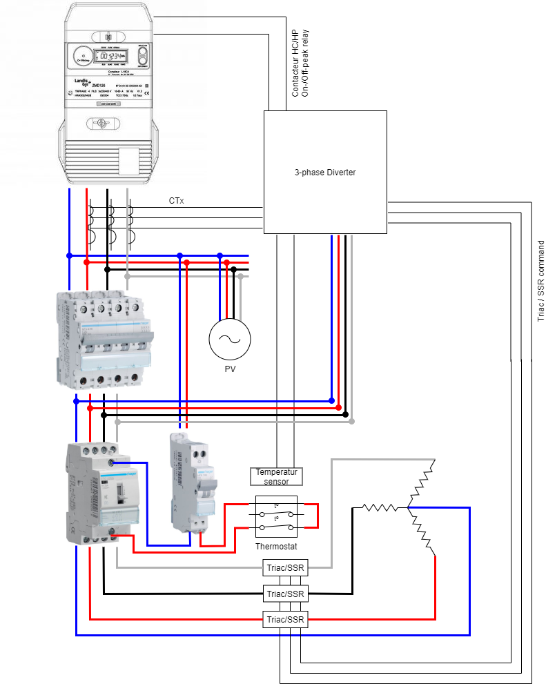
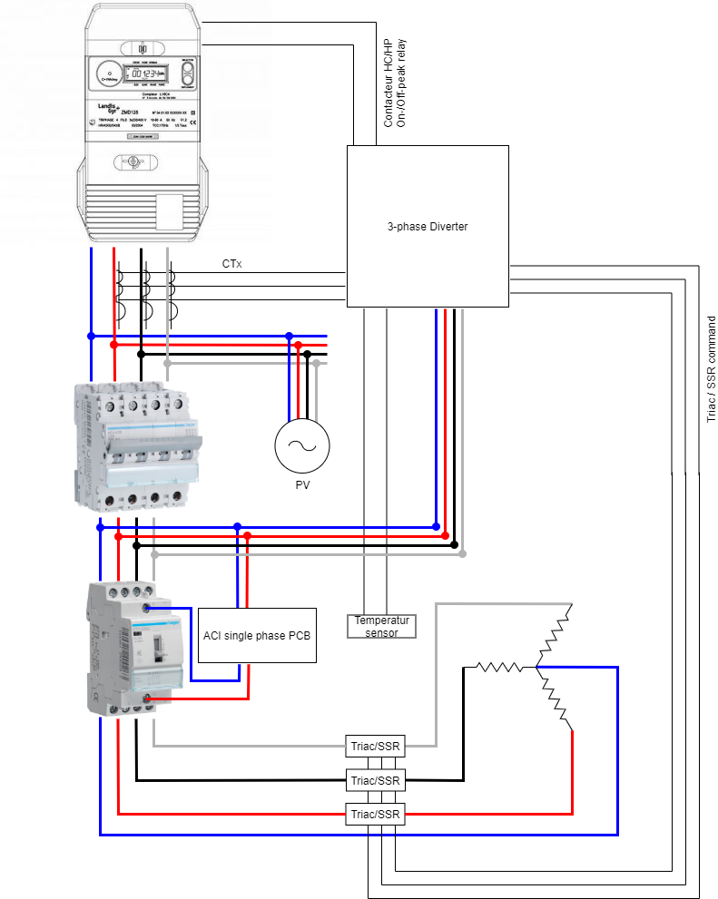
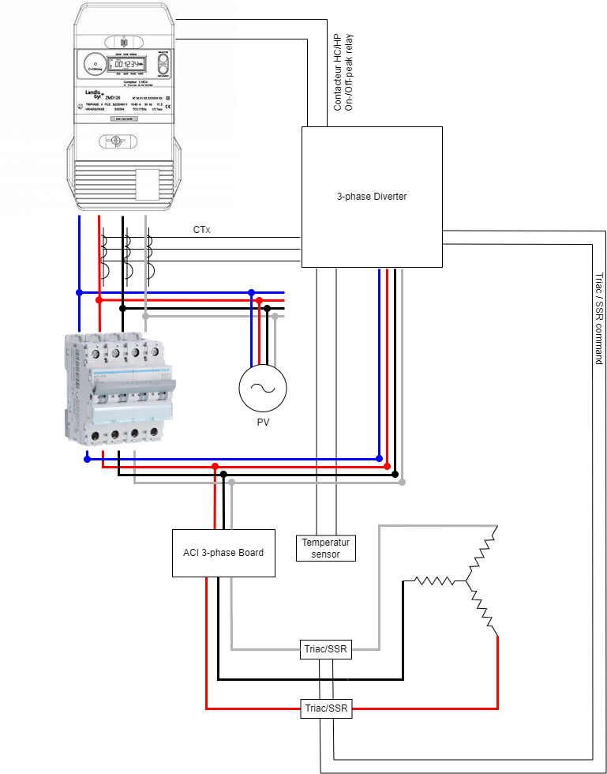
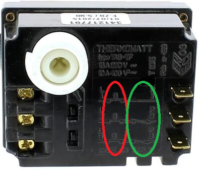
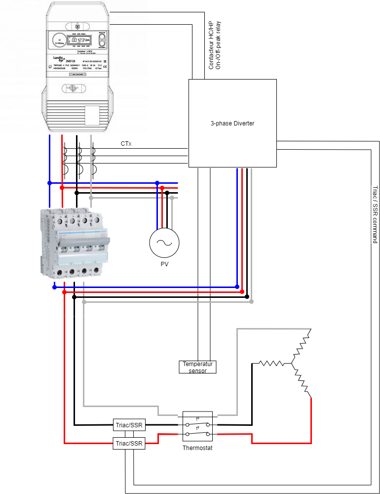

 

 

 
 

 
 
  
  

# PVRouter (3-phase version)

Firmware of a 3-phase photovoltaic diverter for the Arduino Uno (ATmega328P). It measures the power exchanged with the grid on each phase, and sends the surplus of the solar production to resistive loads, typically the heating elements of a water heater, instead of exporting it.

It derives from Robin Emley's [3-phase Mk2PVRouter](https://web.archive.org/web/20220620152349/https://mk2pvrouter.co.uk/3-phase-version.html) (archived), re-engineered since: all the time-critical processing runs in the ADC interrupt, with integer arithmetic only, and the whole configuration is checked at compile time.

> [!NOTE]
> Building or installing a router? The **[user documentation](https://fredm67.github.io/Mk2PVRouter/)** (in French) covers the hardware, the installation, the calibration and the troubleshooting.
> For a single-phase installation, see [PVRouter-1-phase](https://github.com/FredM67/PVRouter-1-phase).

- [PVRouter (3-phase version)](#pvrouter-3-phase-version)
  - [Features](#features)
  - [Getting started](#getting-started)
  - [Repository layout](#repository-layout)
  - [Developer documentation](#developer-documentation)
  - [Zero-export installations (Enphase)](#zero-export-installations-enphase)
- [Wiring use cases](#wiring-use-cases)
  - [Requirements](#requirements)
  - [Heater with mechanical thermostat](#heater-with-mechanical-thermostat)
  - [Heater with ACI single-phase thermostat](#heater-with-aci-single-phase-thermostat)
  - [Heater with ACI 3-phase thermostat (without neutral wire)](#heater-with-aci-3-phase-thermostat-without-neutral-wire)
  - [Alternative without neutral wire](#alternative-without-neutral-wire)
- [Support](#support)
- [Contributing](#contributing)
- [Authors and acknowledgment](#authors-and-acknowledgment)

## Features

What the router does for you:

- **Heats your water with your solar surplus.** As soon as your panels produce more than the house consumes, the router sends the excess to the water heater instead of giving it away to the grid. It matches the surplus exactly: 300 W of surplus means about 300 W in the water heater, without buying power from the grid ([output settings](Mk2_3phase_RFdatalog_temp/Readme.en.md#triac-output-configuration)).
- **Several heating elements, in the order you choose.** The router feeds the first one; once it runs at full power, it moves on to the next. So that they wear evenly, the order can also change every day ([priority rotation](Mk2_3phase_RFdatalog_temp/Readme.en.md#priority-rotation)).
- **Also switches on/off appliances** (a second water heater, a radiator...) through relays: the appliance starts when the surplus is large enough and stops when the house starts buying power again, without reacting to every passing cloud. Works with a home battery too ([relays](Mk2_3phase_RFdatalog_temp/Readme.en.md#onoff-relay-output-configuration)).
- **Controls a distant water heater, wirelessly.** If the water heater is far from the electrical panel, a small unit next to it receives the router's orders by radio ([remote loads](Mk2_3phase_RFdatalog_temp/Readme.en.md#rf-module-and-remote-loads-configuration)).
- **Hot water even without sun.** If the day was not enough, the router heats during off-peak hours, at the time and for the duration you choose, and stops as soon as the water is hot enough ([off-peak hours](Mk2_3phase_RFdatalog_temp/Readme.en.md#off-peak-hours-management-and-scheduled-boost-dual-tariff)). A simple switch can also force full power at any time ([manual boost](Mk2_3phase_RFdatalog_temp/Readme.en.md#manual-boost-pin-triggered)).
- **Knows the water temperature**, with one or more sensors ([temperature sensors](Mk2_3phase_RFdatalog_temp/Readme.en.md#temperature-sensors-configuration)).
- **Pauses while you are away**: either stop diverting (the surplus goes back to the grid, off-peak heating still works), or switch everything off, off-peak heating included ([routing stop](Mk2_3phase_RFdatalog_temp/Readme.en.md#routing-stop), [router OFF](Mk2_3phase_RFdatalog_temp/Readme.en.md#router-off)).
- **Everything in Home Assistant**: power, voltages, temperatures, state of the loads, through the mk2Wifi Wi-Fi module ([mk2Wifi](Mk2_3phase_RFdatalog_temp/Readme.en.md#configuration-with-the-mk2wifi-module)), or on a computer over USB ([serial output](Mk2_3phase_RFdatalog_temp/Readme.en.md#serial-output-type)).
- **Easy calibration**, with a dedicated mode in the firmware ([calibration](Mk2_3phase_RFdatalog_temp/Readme.en.md#router-calibration)).
- **Works with zero-export installations too**, such as Enphase micro-inverters set to export nothing ([below](#zero-export-installations-enphase)).

## Getting started

1. **Hardware and wiring**: the [user documentation](https://fredm67.github.io/Mk2PVRouter/), the [installation guide](docs/HowToInstall.pdf), the [schematic of the motherboard](schematics/3phase_Mainboard.pdf), and the [wiring use cases](#wiring-use-cases) below. A few [pictures](Gallery.md) of assembled routers.
2. **Configuration**: the settings are in `config.h`, the calibration in `calibration.h`. The [configurator](configurator/) writes both, and the ESPHome YAML of the mk2Wifi module, from a web page: open `configurator/index.html` in a browser.
3. **Build and upload**: with [Visual Studio Code and PlatformIO](Mk2_3phase_RFdatalog_temp/Readme.en.md#use-with-visual-studio-code-recommended) (recommended) or the [Arduino IDE](Mk2_3phase_RFdatalog_temp/Readme.en.md#use-with-arduino-ide).
4. **Calibration**: see [router calibration](Mk2_3phase_RFdatalog_temp/Readme.en.md#router-calibration).

## Repository layout

| Folder                                                     | Contents                                                                                  |
| ---------------------------------------------------------- | ----------------------------------------------------------------------------------------- |
| [`Mk2_3phase_RFdatalog_temp`](Mk2_3phase_RFdatalog_temp/)  | the router firmware, its configuration and its tests                                      |
| [`RemoteLoadReceiver`](RemoteLoadReceiver/)                | the firmware of the remote load units (RFM69)                                             |
| [`configurator`](configurator/)                            | the web page that writes the configuration files                                          |
| [`sim`](sim/)                                              | the grid simulator: the firmware runs on a simulated 3-phase grid (simavr)                |
| [`analysis`](analysis/README.en.md)                        | analysis tools for the filtering of the relay outputs (EWMA/TEMA, cloud immunity)         |
| [`dev`](dev/)                                              | development sketches: raw samples of the 6 channels, transformer checker, benchmarks, ... |
| [`docs`](docs/), [`schematics`](schematics/), [`img`](img/) | installation guide, wiring diagrams, schematics, pictures                                 |

## Developer documentation

- [Code documentation](https://fredm67.github.io/PVRouter-3-phase/doc/) (Doxygen) and [firmware size history](https://fredm67.github.io/PVRouter-3-phase/bench/), on the [project site](https://fredm67.github.io/PVRouter-3-phase/).
- [Changelog](CHANGELOG.md) of the changes on `dev`, not yet on `main`.
- [Tests](Mk2_3phase_RFdatalog_temp/test/README.md): native unit tests, and embedded tests and benchmarks in simavr.
- [Grid simulator](sim/README.md): regulation, ISR timing, switching instants, radio and relays, checked in CI.
- [Analysis tools](analysis/README.en.md) : filtering of the relay outputs, tuning for cloudy climates and battery systems.

## Zero-export installations (Enphase)

With a zero-export profile, the PV system curtails its production as soon as it exceeds the consumption of the house: nothing is ever exported. The router therefore never sees any surplus, and has nothing to divert.

The answer is a negative `REQUIRED_EXPORT_IN_WATTS` (in `config_system.h`, see [its description](Mk2_3phase_RFdatalog_temp/Readme.en.md#required_export_in_watts-parameter)): the router then behaves as a small PV generator. With *-20*, it adds -20 W to every measurement:

- when the house **imports** energy, the measurement stays positive: the router does nothing;
- when the measurement is **around zero**, the zero-export limitation is active. With -20 W added, the router sees a surplus, and starts diverting to the water heater. The Envoy sees more consumption and raises the production; the router sees zero again, adds -20 W again, and diverts more. This goes on until the production reaches its maximum: the measurement then stays just above zero, and the system is stable.

Tested on a real installation by Amorim. Depending on the installation, *-20* may need to be raised or lowered.

# Wiring use cases

I want to:

- convert my single-phase water heater with a mechanical thermostat to 3-phase: see [Heater with mechanical thermostat](#heater-with-mechanical-thermostat);
- connect my 3-phase water heater with a mechanical thermostat: see [Heater with mechanical thermostat](#heater-with-mechanical-thermostat);
- convert my ACI single-phase water heater to 3-phase without buying a 3-phase kit: see [Heater with ACI single-phase thermostat](#heater-with-aci-single-phase-thermostat);
- connect my ACI 3-phase water heater: see [Heater with ACI 3-phase thermostat (without neutral wire)](#heater-with-aci-3-phase-thermostat-without-neutral-wire);
- connect several purely resistive loads: wire one on each output, and leave [priority rotation](Mk2_3phase_RFdatalog_temp/Readme.en.md#priority-rotation) off.

## Requirements

To convert a single-phase water heater to 3-phase, it MUST support 3-phase wiring, i.e. have 3 heating elements.

> [!WARNING]
> Changing the wiring means working on 230 V mains. Take great care, and do not undertake it unless you feel confident to do so; if in doubt, call a qualified electrician.

## Heater with mechanical thermostat

### From single-phase to 3-phase (with neutral wire)

> [!NOTE]
> **A router with 3 outputs is needed.** Each heating element is controlled separately.

Separate the 3 heating elements, probably with a new wire for each of them. The elements are often joined by metal "stars": one for the phase, one for the neutral. Remove the one of the phase only; the one of the neutral stays.

### Wiring

On every 3-phase water heater I have seen, the thermostat switches 2 phases only in normal operation (all 3 in safety mode). It must therefore be wired differently, so that all 3 phases are switched.

> [!NOTE]
> In a balanced 3-phase system, no current flows in the neutral: switching off 2 phases out of 3 is enough to switch the device off. That is why most thermostats are built this way.

For this, I "recycled" a 3-phase peak/off-peak contactor, but any 3-phase contactor will do. Its coil can be on any phase, but it must be powered permanently (not through the router), through the thermostat.

*Figure: Wiring diagram*

## Heater with ACI single-phase thermostat

Much the same situation as above: no need to buy a 3-phase kit to convert the heater. The ACI board must be connected to a permanent phase; it then drives any 3-phase contactor.

*Figure: Wiring diagram*

## Heater with ACI 3-phase thermostat (without neutral wire)

> [!NOTE]
> **A router with 2 outputs is needed.** Each heating element is controlled separately.

The ACI board does not cut all 3 phases when the temperature is reached: only 2 are disconnected. The one that stays connected is the middle one on the power connector.

> [!IMPORTANT]
> This phase, which stays permanent, **must not pass through a TRIAC**.

The ACI board must be connected to 3 permanent phases.

*Figure: Wiring diagram*

## Alternative without neutral wire

> [!NOTE]
> **A router with 2 outputs is needed.** No additional neutral wire, and no contactor.

### Heater with mechanical thermostat

This wiring is simpler, and above all needs no 3- or 4-pole contactor.

Look closely at the thermostat to see which terminals it switches:

- in **red**, the safety cut-out (note the "S" on each pole): all 3 phases are switched off;
- in **green**, only 2 phases are switched off, L2 and L3.

> [!IMPORTANT]
> Phase L1, which the thermostat does not switch, **must not pass through a TRIAC**.

*Figure: An example of a thermostat*

*Figure: Wiring diagram*

# Support

This project is maintained by [@FredM67](https://github.com/FredM67). Individual support by email is not possible; help shared publicly is also much more valuable, since everyone can benefit from it.

| Type                                   | Where                                                                         |
| -------------------------------------- | ----------------------------------------------------------------------------- |
| 🚨 **Bug reports**                     | [GitHub Issue Tracker](https://github.com/FredM67/PVRouter-3-phase/issues)    |
| 📚 **Documentation issues**            | [GitHub Issue Tracker](https://github.com/FredM67/PVRouter-3-phase/issues)    |
| 🎁 **Feature requests**                | [GitHub Issue Tracker](https://github.com/FredM67/PVRouter-3-phase/issues)    |
| 🛡 **Report a security vulnerability** | See [SECURITY.md](SECURITY.md)                                                |
| 💬 **General questions**               | [GitHub Discussions](https://github.com/FredM67/PVRouter-3-phase/discussions) |

# Contributing

Please read [CONTRIBUTING.md](CONTRIBUTING.md) for the code of conduct and the process for submitting pull requests.

# Authors and acknowledgment

- **Robin Emley** - the original Mk2PVRouter firmware - [mk2pvrouter.co.uk](https://web.archive.org/web/20231115123017/https://mk2pvrouter.co.uk/) (archived)
- **Frédéric Metrich** - this version - [FredM67](https://github.com/FredM67)

See also the list of [contributors](https://github.com/FredM67/PVRouter-3-phase/graphs/contributors) who participated in this project.
