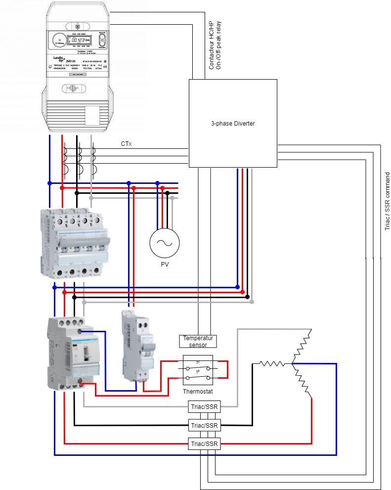
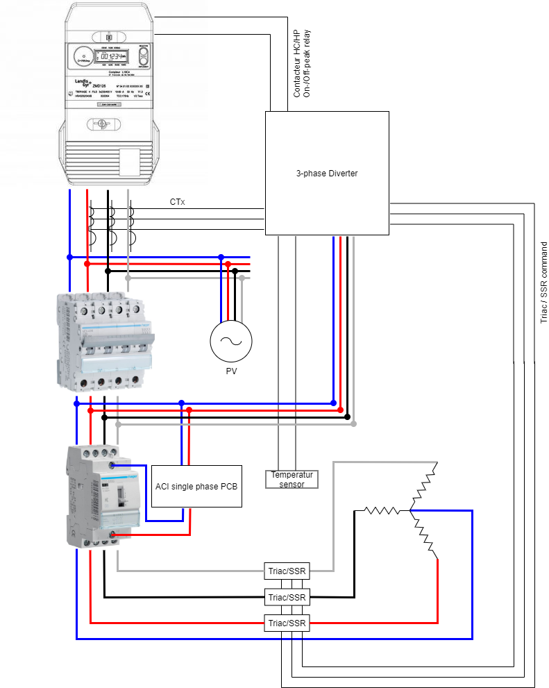
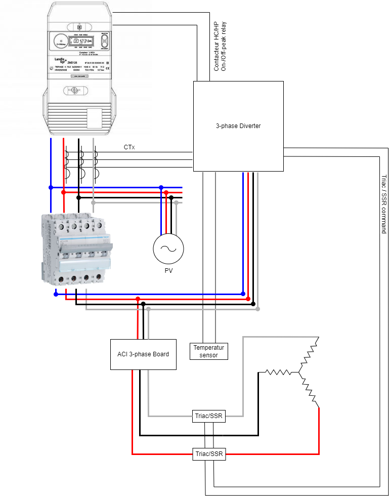
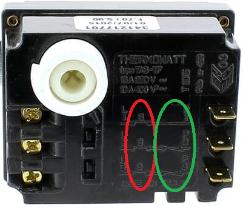
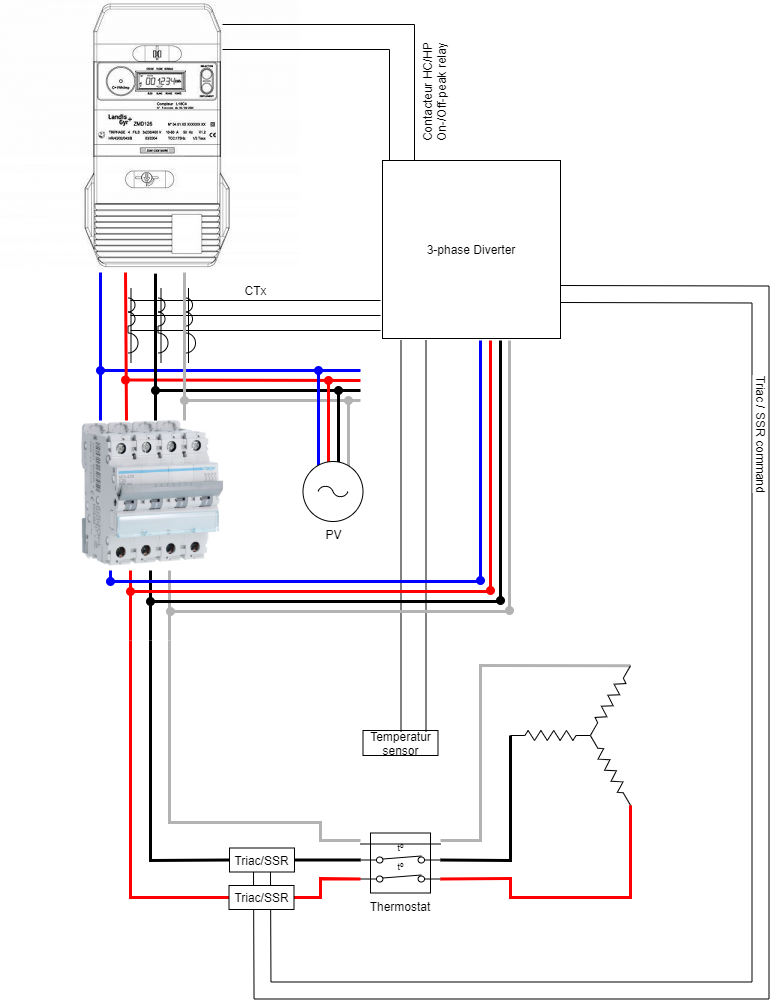

 

 

 
 

 
 
  
  

# PVRouter (version triphasée)

Firmware d’un routeur photovoltaïque triphasé pour l’Arduino Uno (ATmega328P). Il mesure la puissance échangée avec le réseau sur chaque phase, et envoie le surplus de la production solaire vers des charges résistives, typiquement les résistances d’un chauffe-eau, au lieu de l’injecter.

Il est issu du [Mk2PVRouter triphasé](https://web.archive.org/web/20220620152349/https://mk2pvrouter.co.uk/3-phase-version.html) (archive) de Robin Emley, retravaillé depuis : tout le traitement critique en temps se fait dans l’interruption de l’ADC, en arithmétique entière uniquement, et toute la configuration est vérifiée à la compilation.

> [!NOTE]
> Vous construisez ou installez un routeur ? La **[documentation utilisateur](https://fredm67.github.io/Mk2PVRouter/)** couvre le matériel, l’installation, l’étalonnage et le dépannage.
> Pour une installation monophasée, voir [PVRouter-1-phase](https://github.com/FredM67/PVRouter-1-phase).

- [PVRouter (version triphasée)](#pvrouter-version-triphasée)
  - [Fonctionnalités](#fonctionnalités)
  - [Pour commencer](#pour-commencer)
  - [Organisation du dépôt](#organisation-du-dépôt)
  - [Documentation de développement](#documentation-de-développement)
  - [Installations en zéro injection (Enphase)](#installations-en-zéro-injection-enphase)
- [Exemples de câblage](#exemples-de-câblage)
  - [Pré-requis](#pré-requis)
  - [Chauffe-eau avec thermostat mécanique](#chauffe-eau-avec-thermostat-mécanique)
  - [Chauffe-eau avec thermostat ACI monophasé](#chauffe-eau-avec-thermostat-aci-monophasé)
  - [Chauffe-eau avec thermostat ACI triphasé (sans neutre)](#chauffe-eau-avec-thermostat-aci-triphasé-sans-neutre)
  - [Alternative sans neutre](#alternative-sans-neutre)
- [Support](#support)
- [Contribuer](#contribuer)
- [Auteurs et remerciements](#auteurs-et-remerciements)

## Fonctionnalités

- **Sorties TRIAC**, pilotées en proportion du surplus, une charge après l’autre selon leur priorité ([configuration](Mk2_3phase_RFdatalog_temp/Readme.md#configuration-des-sorties-triac)).
- **Sorties relais tout-ou-rien**, avec un seuil de surplus, un seuil d’import, des durées minimales de marche et d’arrêt, et un filtre contre le passage des nuages ; systèmes avec batterie compris ([configuration](Mk2_3phase_RFdatalog_temp/Readme.md#configuration-des-sorties-relais-tout-ou-rien)).
- **Charges distantes** par liaison radio RFM69, pilotées par des unités équipées du firmware [`RemoteLoadReceiver`](RemoteLoadReceiver/) ([configuration](Mk2_3phase_RFdatalog_temp/Readme.md#configuration-du-module-rf-et-des-charges-distantes)).
- **Heures creuses (double tarif)** : boost programmé des charges choisies, arrêté au-delà d’un seuil de température de l’eau ([configuration](Mk2_3phase_RFdatalog_temp/Readme.md#gestion-des-heures-creuses-et-boost-programmé-dual-tariff)).
- **Boost manuel** par une *pin* : un interrupteur, un contact sec, une sortie domotique ([configuration](Mk2_3phase_RFdatalog_temp/Readme.md#boost-manuel-déclenché-par-pin)).
- **Rotation des priorités**, pour que toutes les résistances fonctionnent à peu près autant ([configuration](Mk2_3phase_RFdatalog_temp/Readme.md#rotation-des-priorités)).
- **Capteurs de température** (DS18B20), autant que nécessaire ([configuration](Mk2_3phase_RFdatalog_temp/Readme.md#configuration-du-ou-des-capteurs-de-température)).
- **Arrêt du routage et arrêt du routeur** par des *pins* ([arrêt du routage](Mk2_3phase_RFdatalog_temp/Readme.md#arrêt-du-routage), [routeur à l’arrêt](Mk2_3phase_RFdatalog_temp/Readme.md#routeur-à-larrêt)).
- **Télémétrie** : sortie série lisible pour la mise en service, données pour [Home Assistant via le module mk2Wifi](Mk2_3phase_RFdatalog_temp/Readme.md#configuration-avec-le-module-mk2wifi) (ESPHome), ou JSON ([configuration](Mk2_3phase_RFdatalog_temp/Readme.md#type-de-sortie-série)).
- **Mode étalonnage** intégré au firmware, pour l’ancienne et la nouvelle carte-mère ([étalonnage](Mk2_3phase_RFdatalog_temp/Readme.md#étalonnage-du-routeur)).
- **Installations en zéro injection**, comme Enphase avec son profil zéro export ([plus bas](#installations-en-zéro-injection-enphase)).

## Pour commencer

1. **Matériel et câblage** : la [documentation utilisateur](https://fredm67.github.io/Mk2PVRouter/), la [notice d’installation](docs/HowToInstall.pdf), le [schéma de la carte-mère](schematics/3phase_Mainboard.pdf), et les [exemples de câblage](#exemples-de-câblage) plus bas. Quelques [photos](Gallery.md) de routeurs assemblés.
2. **Configuration** : les réglages sont dans `config.h`, l’étalonnage dans `calibration.h`. Le [configurateur](configurator/) écrit les deux, ainsi que le YAML ESPHome du module mk2Wifi, depuis une page web : ouvrez `configurator/index.html` dans un navigateur.
3. **Compilation et téléversement** : avec [Visual Studio Code et PlatformIO](Mk2_3phase_RFdatalog_temp/Readme.md#utilisation-avec-visual-studio-code-recommandé) (recommandé) ou l’[Arduino IDE](Mk2_3phase_RFdatalog_temp/Readme.md#utilisation-avec-arduino-ide).
4. **Étalonnage** : voir l’[étalonnage du routeur](Mk2_3phase_RFdatalog_temp/Readme.md#étalonnage-du-routeur).

## Organisation du dépôt

| Dossier                                                    | Contenu                                                                                       |
| ---------------------------------------------------------- | --------------------------------------------------------------------------------------------- |
| [`Mk2_3phase_RFdatalog_temp`](Mk2_3phase_RFdatalog_temp/)  | le firmware du routeur, sa configuration et ses tests                                         |
| [`RemoteLoadReceiver`](RemoteLoadReceiver/)                | le firmware des unités de charges distantes (RFM69)                                           |
| [`configurator`](configurator/)                            | la page web qui écrit les fichiers de configuration                                           |
| [`sim`](sim/)                                              | le simulateur de réseau : le firmware tourne sur un réseau triphasé simulé (simavr)           |
| [`analysis`](analysis/README.md)                           | outils d’analyse du filtrage des sorties relais (EWMA/TEMA, immunité aux nuages)              |
| [`dev`](dev/)                                              | programmes de développement : échantillons bruts des 6 canaux, test de transformateur, mesures de performance, ... |
| [`docs`](docs/), [`schematics`](schematics/), [`img`](img/) | notice d’installation, schémas de câblage, schémas électroniques, images                      |

## Documentation de développement

- [Documentation du code](https://fredm67.github.io/PVRouter-3-phase/doc/) (Doxygen, en anglais) et [historique de la taille du firmware](https://fredm67.github.io/PVRouter-3-phase/bench/), sur le [site du projet](https://fredm67.github.io/PVRouter-3-phase/).
- [Journal des modifications](CHANGELOG.md) (en anglais) des changements sur `dev`, pas encore sur `main`.
- [Tests](Mk2_3phase_RFdatalog_temp/test/README.md) (en anglais) : tests unitaires natifs, tests embarqués et mesures de performance dans simavr.
- [Simulateur de réseau](sim/README.md) (en anglais) : régulation, timing de l’ISR, instants de commutation, radio et relais, vérifiés en CI.
- [Outils d’analyse](analysis/README.md)  : filtrage des sorties relais, réglage pour les climats nuageux et les systèmes avec batterie.

## Installations en zéro injection (Enphase)

Avec un profil zéro export, le système PV réduit sa production dès qu’elle dépasse la consommation de la maison : rien n’est jamais injecté. Le routeur ne voit donc jamais de surplus, et n’a rien à router.

La solution est un `REQUIRED_EXPORT_IN_WATTS` négatif (dans `config_system.h`, voir [sa description](Mk2_3phase_RFdatalog_temp/Readme.md#paramètre-required_export_in_watts)) : le routeur se comporte alors comme un petit générateur PV. Avec *-20*, il ajoute -20 W à chaque mesure :

- quand la maison **importe**, la mesure reste positive : le routeur ne fait rien ;
- quand la mesure est **autour de zéro**, la limitation zéro export est active. Avec -20 W ajoutés, le routeur voit un surplus, et commence à router vers le chauffe-eau. L’Envoy voit plus de consommation et augmente la production ; le routeur revoit zéro, ajoute à nouveau -20 W, et route davantage. Cela continue jusqu’à ce que la production atteigne son maximum : la mesure reste alors juste au-dessus de zéro, et le système est stable.

Testé sur une installation réelle par Amorim. Selon l’installation, *-20* peut devoir être augmenté ou diminué.

# Exemples de câblage

Je veux :

- passer mon chauffe-eau monophasé à thermostat mécanique en triphasé : voir [Chauffe-eau avec thermostat mécanique](#chauffe-eau-avec-thermostat-mécanique) ;
- raccorder mon chauffe-eau triphasé à thermostat mécanique : voir [Chauffe-eau avec thermostat mécanique](#chauffe-eau-avec-thermostat-mécanique) ;
- passer mon chauffe-eau ACI monophasé en triphasé sans acheter de kit triphasé : voir [Chauffe-eau avec thermostat ACI monophasé](#chauffe-eau-avec-thermostat-aci-monophasé) ;
- raccorder mon chauffe-eau ACI triphasé : voir [Chauffe-eau avec thermostat ACI triphasé (sans neutre)](#chauffe-eau-avec-thermostat-aci-triphasé-sans-neutre) ;
- raccorder plusieurs charges purement résistives : une sur chaque sortie, en laissant la [rotation des priorités](Mk2_3phase_RFdatalog_temp/Readme.md#rotation-des-priorités) désactivée.

## Pré-requis

Pour passer un chauffe-eau monophasé en triphasé, il DOIT supporter le câblage triphasé, c’est-à-dire avoir 3 résistances.

> [!WARNING]
> Modifier le câblage implique d’intervenir sur le réseau 230 V. Soyez sûr de ce que vous entreprenez ; au moindre doute, faites appel à un électricien qualifié.

## Chauffe-eau avec thermostat mécanique

### Passage du monophasé au triphasé (avec neutre)

> [!NOTE]
> **Nécessite un routeur avec 3 sorties.** Chaque résistance est pilotée séparément.

Séparez les 3 résistances, probablement avec un nouveau fil pour chacune. Elles sont souvent reliées par des « étoiles » métalliques : une pour la phase, une pour le neutre. Retirez uniquement celle de la phase ; celle du neutre reste en place.

### Câblage

Sur tous les chauffe-eau triphasés que j’ai vus, le thermostat ne coupe que 2 phases en fonctionnement normal (les 3 en mode sécurité). Il doit donc être câblé autrement, pour que les 3 phases soient coupées.

> [!NOTE]
> Dans un système triphasé équilibré, aucun courant ne circule dans le neutre : couper 2 phases sur 3 suffit à éteindre l’appareil. C’est pourquoi la plupart des thermostats sont construits ainsi.

Pour cela, j’ai « recyclé » un contacteur HC/HP triphasé, mais n’importe quel contacteur triphasé convient. Sa bobine peut être sur n’importe quelle phase, mais elle doit être alimentée en permanence (pas à travers le routeur), à travers le thermostat.

*Figure : Schéma de câblage*

## Chauffe-eau avec thermostat ACI monophasé

La situation est à peu près la même que ci-dessus : pas besoin d’acheter un kit triphasé pour convertir le chauffe-eau. La carte ACI doit être reliée à une phase permanente ; elle commande ensuite n’importe quel contacteur triphasé.

*Figure : Schéma de câblage*

## Chauffe-eau avec thermostat ACI triphasé (sans neutre)

> [!NOTE]
> **Nécessite un routeur avec 2 sorties.** Chaque résistance est pilotée séparément.

La carte ACI ne coupe pas les 3 phases quand la température est atteinte : seules 2 sont coupées. Celle qui reste raccordée correspond au fil du milieu du connecteur de puissance.

> [!IMPORTANT]
> Cette phase, qui reste permanente, **ne doit pas passer par un TRIAC**.

La carte ACI doit être reliée à 3 phases permanentes.

*Figure : Schéma de câblage*

## Alternative sans neutre

> [!NOTE]
> **Nécessite un routeur avec 2 sorties.** Pas de fil de neutre supplémentaire, et pas de contacteur.

### Chauffe-eau avec thermostat mécanique

Ce câblage est plus simple, et surtout ne nécessite aucun contacteur tri- ou quadripolaire.

Regardez bien sur le thermostat quelles bornes il coupe :

- en **rouge**, la coupure de sécurité (remarquez le « S » sur chaque contact) : les 3 phases sont coupées ;
- en **vert**, seules 2 phases sont coupées, L2 et L3.

> [!IMPORTANT]
> La phase L1, que le thermostat ne coupe pas, **ne doit pas passer par un TRIAC**.

*Figure : Exemple de thermostat*

*Figure : Schéma de câblage*

# Support

Ce projet est maintenu par [@FredM67](https://github.com/FredM67). Il n’est pas possible d’assurer un support individuel par e-mail ; une aide partagée publiquement est d’ailleurs bien plus utile, puisque tout le monde peut en profiter.

| Type                                         | Où                                                                                  |
| -------------------------------------------- | ----------------------------------------------------------------------------------- |
| 🚨 **Signaler un bug**                       | [GitHub Issue Tracker](https://github.com/FredM67/PVRouter-3-phase/issues)          |
| 📚 **Problème de documentation**             | [GitHub Issue Tracker](https://github.com/FredM67/PVRouter-3-phase/issues)          |
| 🎁 **Demande de fonctionnalité**             | [GitHub Issue Tracker](https://github.com/FredM67/PVRouter-3-phase/issues)          |
| 🛡 **Signaler une faille de sécurité**       | Voir [SECURITY.md](SECURITY.md)                                                     |
| 💬 **Questions générales**                   | [GitHub Discussions](https://github.com/FredM67/PVRouter-3-phase/discussions)       |

# Contribuer

Lisez [CONTRIBUTING.md](CONTRIBUTING.md) (en anglais) pour le code de conduite et la façon de proposer des *pull requests*.

# Auteurs et remerciements

- **Robin Emley** - le firmware Mk2PVRouter d’origine - [mk2pvrouter.co.uk](https://web.archive.org/web/20231115123017/https://mk2pvrouter.co.uk/) (archive)
- **Frédéric Metrich** - cette version - [FredM67](https://github.com/FredM67)

Voir aussi la liste des [contributeurs](https://github.com/FredM67/PVRouter-3-phase/graphs/contributors) qui ont participé à ce projet.
