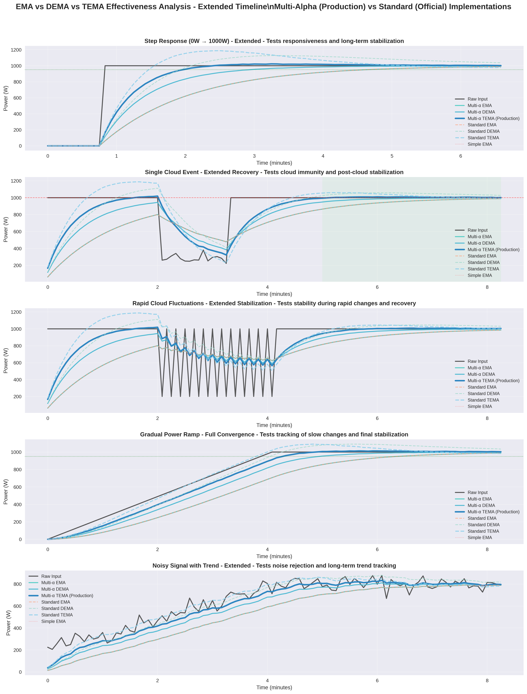
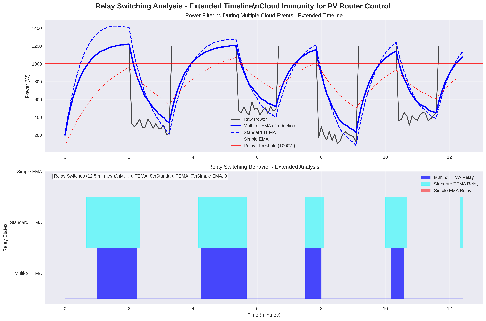
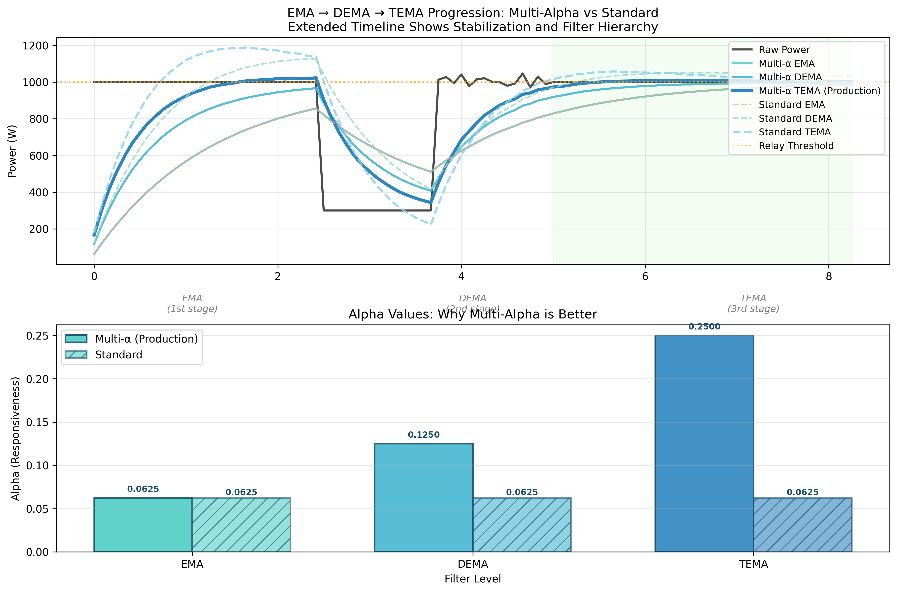

# EMA/DEMA/TEMA Effectiveness Analysis

[](TEMA_ANALYSIS_README.md) [](TEMA_ANALYSIS_README.en.md)

---

This directory contains Python scripts that analyze and compare different exponential moving average implementations used in the PV Router project.

## 📈 Analysis Results

### Comprehensive Filter Comparison



**Key observations:**
- **Multi-Alpha TEMA** (blue solid): Optimal balance of responsiveness and stability
- **Standard TEMA** (blue dashed): More conservative, slower convergence
- **Simple EMA** (orange): Fast but noisy, poor cloud immunity

### Relay Control Analysis



**Performance metrics:**
- **Multi-α TEMA**: Minimal relay switching, excellent stability
- **Standard TEMA**: Good performance, slightly more switching
- **Simple EMA**: Excessive switching during cloud events

### TEMA Implementation Comparison



**Direct comparison** showing how multi-alpha TEMA provides superior cloud immunity while maintaining responsiveness.

## 📊 Available Scripts

### 1. Comprehensive Analysis
```bash
cd analysis/scripts
python3 ema_effectiveness_analysis_extended.py
```

**Generates** (in `analysis/plots/`):
- `ema_dema_tema_comparison_extended.png` - filter comparison across several scenarios
- `relay_switching_analysis_extended.png` - relay switching during cloud events

**What it analyzes:**
- **Multi-Alpha TEMA** (the firmware implementation)
- **Standard TEMA** (official single-alpha formula)
- **Simple EMA** baseline
- Step response, cloud immunity, noise rejection
- Relay switching frequency during cloud events

### 2. TEMA Implementation Comparison
```bash
cd analysis/scripts
python3 tema_comparison.py
```

**Generates** (in `analysis/plots/`):
- `tema_implementation_comparison.png` - Focused comparison of TEMA implementations

The other pictures of `analysis/plots/` (`ema_dema_tema_comparison.png`, `filter_performance_analysis.png`, `relay_switching_analysis.png`) come from an earlier version of the script.

## 🔍 Key Findings

### Why Multi-Alpha TEMA is Superior

**The firmware implementation (`ewma_avg.hpp`):**
```cpp
ema = ema_raw >> round_up_to_power_of_2(A);           // Base smoothing
ema_ema = ema_ema_raw >> (round_up_to_power_of_2(A) - 1);     // 2x faster
ema_ema_ema = ema_ema_ema_raw >> (round_up_to_power_of_2(A) - 2); // 4x faster
return 3 * (ema - ema_ema) + ema_ema_ema;            // TEMA formula
```

**Standard Implementation:**
```cpp
// All levels use the same alpha - less optimal
ema = ema_raw >> round_up_to_power_of_2(A);
ema_ema = ema_ema_raw >> round_up_to_power_of_2(A);   // Same alpha!
ema_ema_ema = ema_ema_ema_raw >> round_up_to_power_of_2(A); // Same alpha!
```

### Performance Comparison

| Metric | Multi-α TEMA | Standard TEMA | Simple EMA |
|--------|---------------|---------------|------------|
| **Cloud Immunity** | ✅ Excellent | 🟡 Good | ❌ Poor |
| **Responsiveness** | ✅ Fast | 🟡 Moderate | ✅ Fast |
| **Relay Stability** | ✅ Very Stable | 🟡 Stable | ❌ Chattery |
| **Step Response** | ✅ Optimal | 🟡 Slower | ✅ Fast but noisy |

### Alpha Values Breakdown

For A=24 (2-minute delay):
- **EMA**: α = 1/16 (stable base)
- **EMA_EMA**: α = 1/8 (2x faster - tracks medium changes)
- **EMA_EMA_EMA**: α = 1/4 (4x faster - captures short-term trends)

This creates a **perfect balance**:
- Long-term stability from slow EMA
- Medium-term trend tracking from 2x EMA_EMA
- Short-term responsiveness from 4x EMA_EMA_EMA
- TEMA formula combines all three intelligently

## 🎯 Practical Benefits for PV Router

1. **Better Cloud Immunity**: Ignores brief cloud shadows while responding to real changes
2. **Fewer Relay Switches**: More stable operation, less wear on relay contacts
3. **Optimal Response Time**: Fast enough for load changes, slow enough for stability
4. **Reduced Grid Disturbance**: Smoother power flow to the grid

## 📈 How to Read the Graphs

### Main Comparison Plot
- **Solid lines**: Multi-alpha implementation (production)
- **Dashed lines**: Standard implementation
- **Dotted lines**: Simple EMA baseline
- **Thick blue line**: Multi-α TEMA (recommended for relay control)

### Performance Analysis
- **Step Response**: Shows how quickly filters reach target values
- **Cloud Immunity**: Tests response to brief power drops
- **Alpha Visualization**: Shows different responsiveness levels
- **Settling Time**: Time to reach 95% of final value

### Relay Switching Analysis
- **Power curves**: How different filters respond to cloud events
- **Relay states**: ON/OFF behavior for each filter type
- **Switch count**: Number of relay operations (lower = better)

## 📋 Requirements

- Python 3.x
- matplotlib
- numpy

`ema_effectiveness_analysis_extended.py` installs matplotlib and numpy if they are missing.
