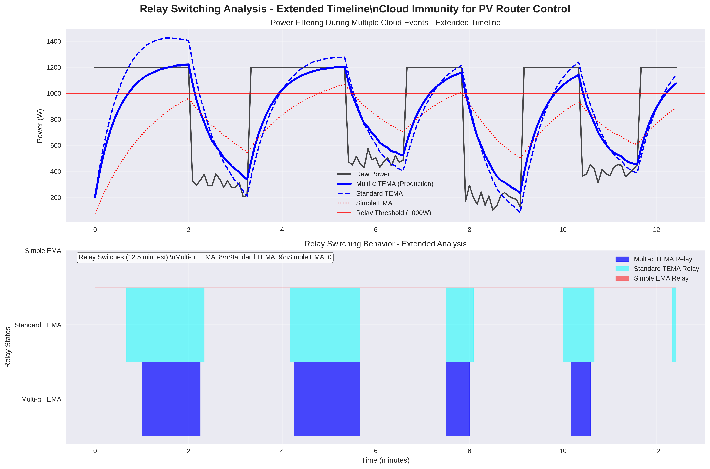
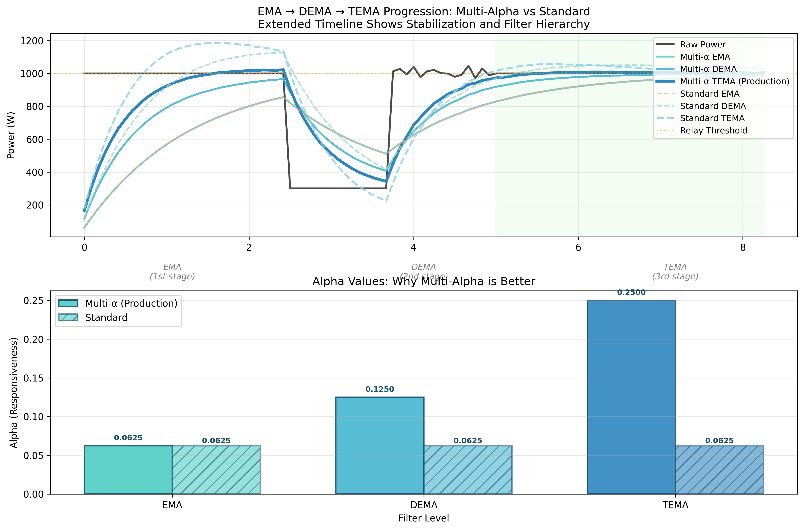

# Analyse de l'Efficacité EMA/DEMA/TEMA

[](TEMA_ANALYSIS_README.md) [](TEMA_ANALYSIS_README.en.md)

---

Ce répertoire contient des scripts Python qui analysent et comparent différentes implémentations de moyennes mobiles exponentielles utilisées dans le projet PV Router.

## 📈 Résultats d'Analyse

### Comparaison Complète des Filtres


**Observations clés :**
- **TEMA Multi-Alpha** (bleu plein) : Équilibre optimal entre réactivité et stabilité
- **TEMA Standard** (bleu pointillé) : Plus conservateur, convergence plus lente
- **EMA Simple** (orange) : Rapide mais bruyant, mauvaise immunité aux nuages

### Analyse du Contrôle des Relais



**Métriques de performance :**
- **TEMA Multi-α** : Commutation minimale des relais, excellente stabilité
- **TEMA Standard** : Bonnes performances, légèrement plus de commutations
- **EMA Simple** : Commutation excessive lors d'événements nuageux

### Comparaison des Implémentations TEMA



**Comparaison directe** montrant comment TEMA multi-alpha offre une immunité aux nuages supérieure tout en maintenant la réactivité.

## 📊 Scripts Disponibles

### 1. Analyse Complète
```bash
cd analysis/scripts
python3 ema_effectiveness_analysis_extended.py
```

**Génère** (dans `analysis/plots/`) :
- `ema_dema_tema_comparison_extended.png` - comparaison des filtres sur plusieurs scénarios
- `relay_switching_analysis_extended.png` - commutation des relais lors d'événements nuageux

**Ce qu'il analyse :**
- **TEMA Multi-Alpha** (l'implémentation du firmware)
- **TEMA Standard** (formule single-alpha officielle)
- **EMA Simple** ligne de base
- Réponse à l'échelon, immunité aux nuages, rejet du bruit
- Fréquence de commutation des relais lors d'événements nuageux

### 2. Comparaison des Implémentations TEMA
```bash
cd analysis/scripts
python3 tema_comparison.py
```

**Génère** (dans `analysis/plots/`) :
- `tema_implementation_comparison.png` - Comparaison ciblée des implémentations TEMA

Les autres images de `analysis/plots/` (`ema_dema_tema_comparison.png`, `filter_performance_analysis.png`, `relay_switching_analysis.png`) viennent d'une version précédente du script.

## 🔍 Principales Découvertes

### Pourquoi TEMA Multi-Alpha est Supérieur

**L’implémentation du firmware (`ewma_avg.hpp`) :**
```cpp
ema = ema_raw >> round_up_to_power_of_2(A);           // Lissage de base
ema_ema = ema_ema_raw >> (round_up_to_power_of_2(A) - 1);     // 2x plus rapide
ema_ema_ema = ema_ema_ema_raw >> (round_up_to_power_of_2(A) - 2); // 4x plus rapide
return 3 * (ema - ema_ema) + ema_ema_ema;            // Formule TEMA
```

**Implémentation Standard :**
```cpp
// Tous les niveaux utilisent le même alpha - moins optimal
ema = ema_raw >> round_up_to_power_of_2(A);
ema_ema = ema_ema_raw >> round_up_to_power_of_2(A);   // Même alpha !
ema_ema_ema = ema_ema_ema_raw >> round_up_to_power_of_2(A); // Même alpha !
```

### Comparaison des Performances

| Métrique | TEMA Multi-α | TEMA Standard | EMA Simple |
|----------|--------------|---------------|------------|
| **Immunité aux Nuages** | ✅ Excellente | 🟡 Bonne | ❌ Pauvre |
| **Réactivité** | ✅ Rapide | 🟡 Modérée | ✅ Rapide |
| **Stabilité des Relais** | ✅ Très Stable | 🟡 Stable | ❌ Instable |
| **Réponse à l'Échelon** | ✅ Optimale | 🟡 Plus Lente | ✅ Rapide mais bruyante |

### Détail des Valeurs Alpha

Pour A=24 (délai de 2 minutes) :
- **EMA** : α = 1/16 (base stable)
- **EMA_EMA** : α = 1/8 (2x plus rapide - suit les changements moyens)
- **EMA_EMA_EMA** : α = 1/4 (4x plus rapide - capture les tendances court terme)

Cela crée un **équilibre parfait** :
- Stabilité long terme grâce à l'EMA lent
- Suivi des tendances moyen terme grâce à l'EMA_EMA 2x
- Réactivité court terme grâce à l'EMA_EMA_EMA 4x
- La formule TEMA combine intelligemment les trois

## 🎯 Avantages Pratiques pour le Routeur PV

1. **Meilleure Immunité aux Nuages** : Ignore les ombres nuageuses brèves tout en répondant aux vrais changements
2. **Moins de Commutations de Relais** : Fonctionnement plus stable, moins d'usure des contacts de relais
3. **Temps de Réponse Optimal** : Assez rapide pour les changements de charge, assez lent pour la stabilité
4. **Réduction des Perturbations Réseau** : Flux de puissance plus lisse vers le réseau

## 📈 Comment Lire les Graphiques

### Graphique de Comparaison Principal
- **Lignes pleines** : Implémentation multi-alpha (production)
- **Lignes pointillées** : Implémentation standard
- **Lignes pointées** : Ligne de base EMA simple
- **Ligne bleue épaisse** : TEMA Multi-α (recommandé pour le contrôle des relais)

### Analyse des Performances
- **Réponse à l'Échelon** : Montre la rapidité d'atteinte des valeurs cibles par les filtres
- **Immunité aux Nuages** : Teste la réponse aux chutes de puissance brèves
- **Visualisation Alpha** : Montre les différents niveaux de réactivité
- **Temps d'Établissement** : Temps pour atteindre 95% de la valeur finale

### Analyse de Commutation des Relais
- **Courbes de puissance** : Comment les différents filtres répondent aux événements nuageux
- **États des relais** : Comportement ON/OFF pour chaque type de filtre
- **Nombre de commutations** : Nombre d'opérations de relais (plus bas = meilleur)

## 📋 Prérequis

- Python 3.x
- matplotlib
- numpy

`ema_effectiveness_analysis_extended.py` installe matplotlib et numpy s'ils manquent.
